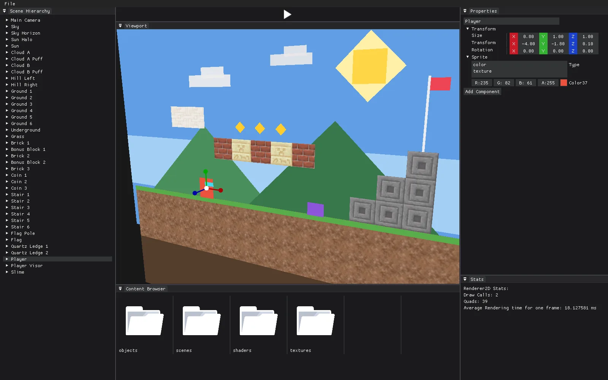
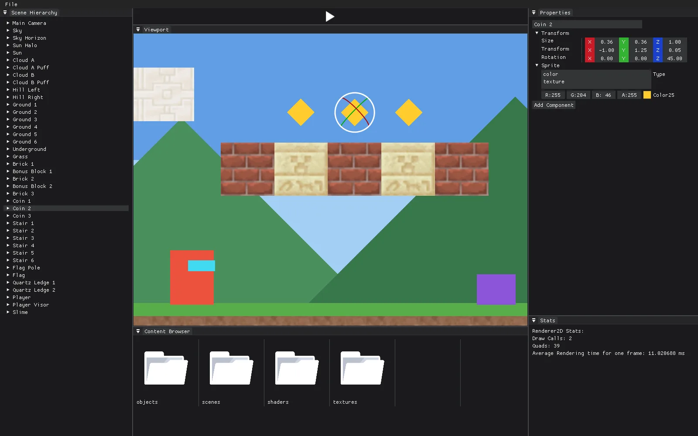

# GameEngine

A 2D game engine and level editor in Java, built on OpenGL 4.5 with LWJGL. It follows the architecture of [TheCherno's Hazel](https://github.com/TheCherno/Hazel) engine, ported from C++ to Java.


 

The screenshots show a demo level; scene files aren't kept in the repo.

## Features

- A level editor with docking panels: scene hierarchy, properties, content browser and render stats.
- Entities with a sprite (a colour or a texture), moved, rotated and scaled with gizmos.
- Click an entity in the viewport to select it.
- Scenes saved and opened as YAML, with stable IDs for every entity. Drag textures and scenes in from the content browser.
- Orthographic and perspective cameras, plus an editor camera that orbits, pans and zooms.
- Play runs a copy of the scene through its primary camera; Stop throws the copy away and returns to the scene as it was.

## How it works

- **Batch renderer:** up to 2,000 quads per draw call with 32 texture slots. Slot 0 is a white texture, so plain colours share the same shader.
- **Entity-component system:** built on artemis-odb, with Tag, Id, Transform, Sprite and Camera components. Camera updates and rendering run as systems.
- **Mouse picking:** each entity's ID is drawn into a second framebuffer attachment, and the pixel under the mouse is read back.
- **OpenGL 4.5** with direct state access, and GL debug output routed to log4j.
- **Layers and events:** input arrives as events that pass through a layer stack, as in Hazel.
- The engine reaches OpenGL only through interfaces, so another graphics API could be added.

## Editor controls

| Action | Keys |
| --- | --- |
| New, open, save, save as scene | Ctrl+N, Ctrl+O, Ctrl+S, Ctrl+Shift+S |
| No gizmo, move, rotate, scale | Q, W, E, R (hold Ctrl to snap) |
| Duplicate the selected entity | Ctrl+D |
| Orbit, pan, zoom the camera | Alt + left, middle, right mouse; or scroll to zoom |

## Modules

- `GameEngine`: the engine.
- `Editor`: the level editor.

## Running it

You need a GPU with OpenGL 4.5. The build picks the LWJGL and ImGui native libraries for the system it runs on, but the engine has only been run on Windows, and macOS stops at OpenGL 4.1, so it won't run there.

The project builds and runs on JDK 21. The build sets this with a Gradle toolchain, so Gradle uses an installed JDK 21 or downloads one. Gradle itself needs JDK 17 or newer to start.

From a terminal in the project root:

```
.\gradlew.bat :Editor:run
```

The editor opens the project you last worked on. The first time, or when that project is gone, it shows a project picker with your recent projects and buttons to open a project or make a new one. To open a particular project, pass its project file, or the folder that holds it, as the first argument, e.g. `.\gradlew.bat :Editor:run --args="C:\path\to\MyGame"`. Projects live outside this repository.

A project is a folder with a project file named after the project, such as `MyGame.geproj`, and an `assets` folder. Textures, scenes and the content browser all live in `assets`, and scenes store texture paths relative to the project, so a project can be moved or shared. The project file is YAML and names the scene the editor opens first:

```
startScene: assets/scenes/level1.yaml
```

**New Project** asks for an empty folder and makes the project file, `assets/scenes` and `assets/textures` in it. The project takes the folder's name. In a folder that already has an `assets` folder, it keeps the assets and adds the project file.

In the editor, the **File** menu has the scene commands, then **New Project**, **Open Project**, **Recent Projects** and **Close Project**, which goes back to the picker. **Use as Start Scene** makes the open scene, once saved, the one the project starts with; it is ticked when it already is, and choosing it again clears the start scene.

Before the editor opens another scene or project, or closes, it asks whether to save the scene's changes. **Yes** saves them, asking where for a scene that has never been saved, **No** throws them away and **Cancel** stays.

In IntelliJ IDEA, set the project SDK to JDK 21 and run `Editor/src/main/java/Editor/Main.java` with a project file or folder as the program argument. The engine's shaders and the editor's icons are packed into the jars, so the editor does not need a particular working directory.

## Packaging the editor

```
.\gradlew.bat :Editor:jpackage
```

This builds `Editor/build/package/Editor`, a folder with `Editor.exe` and its own Java runtime, so it runs on machines without Java. Copy the whole folder. Started by itself it opens the last project or the picker, and it takes a project the same way, e.g. `Editor.exe C:\path\to\MyGame`. On Windows a console window opens next to the editor and shows the log.

The runtime holds only the Java modules the editor's libraries use, listed as `runtimeModules` in `Editor/build.gradle`, so the folder is about 90 MB instead of 160 MB. After adding a library, run the task and compare that list with the last line of:

```
jdeps --print-module-deps --ignore-missing-deps --multi-release 21 (Get-ChildItem Editor\build\install\Editor\lib\*.jar).FullName
```

The package only holds the native libraries for the system that built it, so build it on Linux to get a Linux version. `.\gradlew.bat :Editor:distZip` makes a smaller zip without a Java runtime, for machines that have Java 21 installed.

## Project layout

- `GameEngine/src/main/resources/engine/`: shaders the renderer needs.
- `Editor/src/main/resources/Icons/`: editor icons.

On first launch the editor docks its panels into a default layout, and **Window > Reset Layout** restores it. The editor saves its layout per user, to `%APPDATA%\GameEngine\Editor\imgui.ini` on Windows and `~/.config/GameEngine/Editor/imgui.ini` elsewhere. The editor keeps its list of recent projects next to it, in `recent-projects.txt`.
