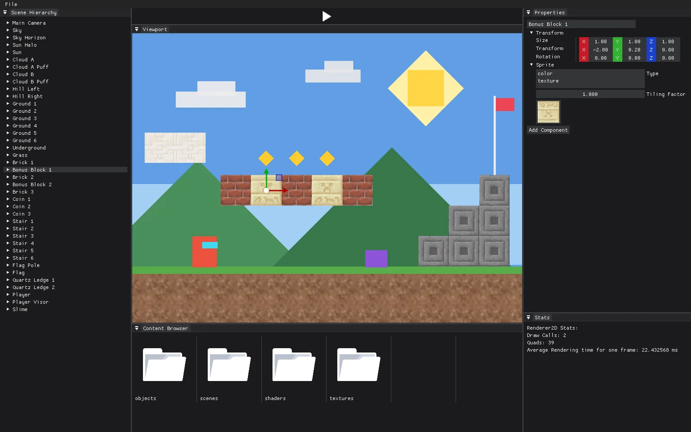

# GameEngine

A 2D game engine and level editor in Java, built on OpenGL 4.5 with LWJGL. It follows the architecture of [TheCherno's Hazel](https://github.com/TheCherno/Hazel) engine, ported from C++ to Java.



 

The screenshots show a demo level; scene files aren't kept in the repo.

## Features

- A level editor with docking panels: scene hierarchy, properties, content browser and render stats.
- Entities with a sprite (a colour or a texture), moved, rotated and scaled with gizmos.
- Click an entity in the viewport to select it.
- Scenes saved and opened as YAML, with stable IDs for every entity. Drag textures and scenes in from the content browser.
- Orthographic and perspective cameras, plus an editor camera that orbits, pans and zooms.
- Play runs a copy of the scene through its primary camera; Stop throws the copy away and returns to the scene as it was.

## How it works

- **Batch renderer:** up to 2,000 quads per draw call with 32 texture slots. Slot 0 is a white texture, so plain colours share the same shader.
- **Entity-component system:** built on artemis-odb, with Tag, Id, Transform, Sprite and Camera components. Camera updates and rendering run as systems.
- **Mouse picking:** each entity's ID is drawn into a second framebuffer attachment, and the pixel under the mouse is read back.
- **OpenGL 4.5** with direct state access, and GL debug output routed to log4j.
- **Layers and events:** input arrives as events that pass through a layer stack, as in Hazel.
- The engine reaches OpenGL only through interfaces, so another graphics API could be added.

## Editor controls

| Action | Keys |
| --- | --- |
| New, open, save, save as | Ctrl+N, Ctrl+O, Ctrl+S, Ctrl+Shift+S |
| No gizmo, move, rotate, scale | Q, W, E, R (hold Ctrl to snap) |
| Duplicate the selected entity | Ctrl+D |
| Orbit, pan, zoom the camera | Alt + left, middle, right mouse; or scroll to zoom |

## Modules

- `GameEngine`: the engine.
- `Editor`: the level editor.
- `SandBox`: a test app with one example layer per experiment. By default it draws a 50×50 grid of coloured quads with the batch renderer; pick another layer in `Sandbox.java`, such as the textured cube (`ExampleLayer3D`), the shader art (`ExampleLayerFragmentShader`) or the original batch shader (`ExampleLayerBatchShader`).

## Running it

You need a GPU with OpenGL 4.5. The build picks the LWJGL and ImGui native libraries for the system it runs on, but the engine has only been run on Windows, and macOS stops at OpenGL 4.1, so it won't run there.

The project builds and runs on JDK 21. The build sets this with a Gradle toolchain, so Gradle uses an installed JDK 21 or downloads one. Gradle itself needs JDK 17 or newer to start.

From a terminal in the project root:

```
.\gradlew.bat :Editor:run
.\gradlew.bat :SandBox:run
```

The editor opens a project folder, given as its first argument; `:Editor:run` opens `SampleProject`. Textures, scenes and the content browser all live in the project's `assets` folder, and scenes store texture paths relative to the project, so a project can be moved or shared. Without an argument the editor uses the current folder as the project.

In IntelliJ IDEA, set the project SDK to JDK 21 and run `Editor/src/main/java/Editor/Main.java` with `SampleProject` as the program argument. Run `SandBox/src/main/java/Main.java` as it is. The engine's shaders, the editor's icons and the sandbox's textures are packed into each module's jar, so neither app needs a particular working directory.

## Project layout

- `GameEngine/src/main/resources/engine/`: shaders the renderer needs.
- `Editor/src/main/resources/Icons/`: editor icons.
- `SandBox/src/main/resources/`: the sandbox's textures and shaders.
- `SampleProject/assets/`: the sample project's textures. Scenes you save go in `assets/scenes`, which git ignores.

On first launch the editor docks its panels into a default layout, and **Window > Reset Layout** restores it. Each app saves its layout per user in its own folder, to `%APPDATA%\GameEngine\Editor\imgui.ini` on Windows and `~/.config/GameEngine/Editor/imgui.ini` elsewhere (`SandBox` for the sandbox).
