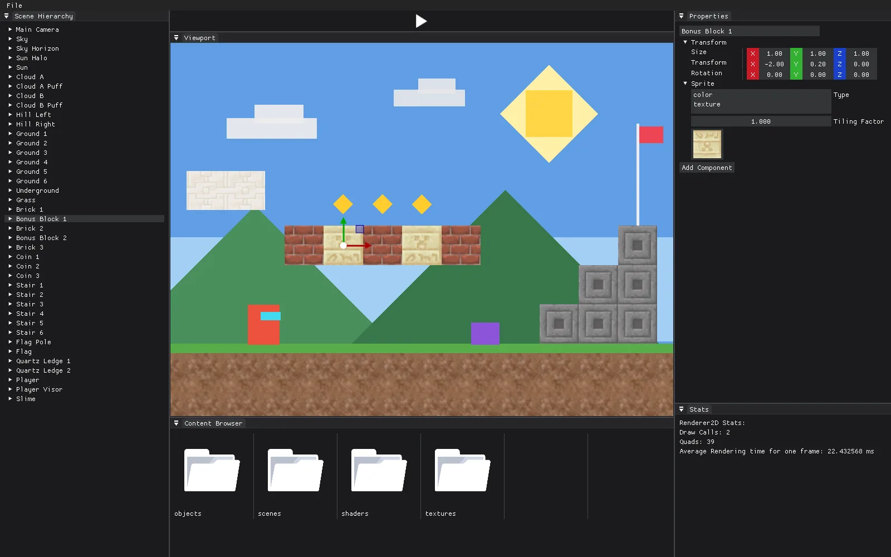
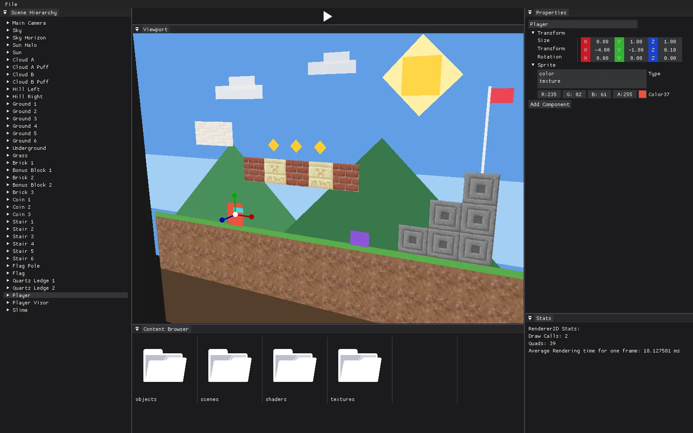
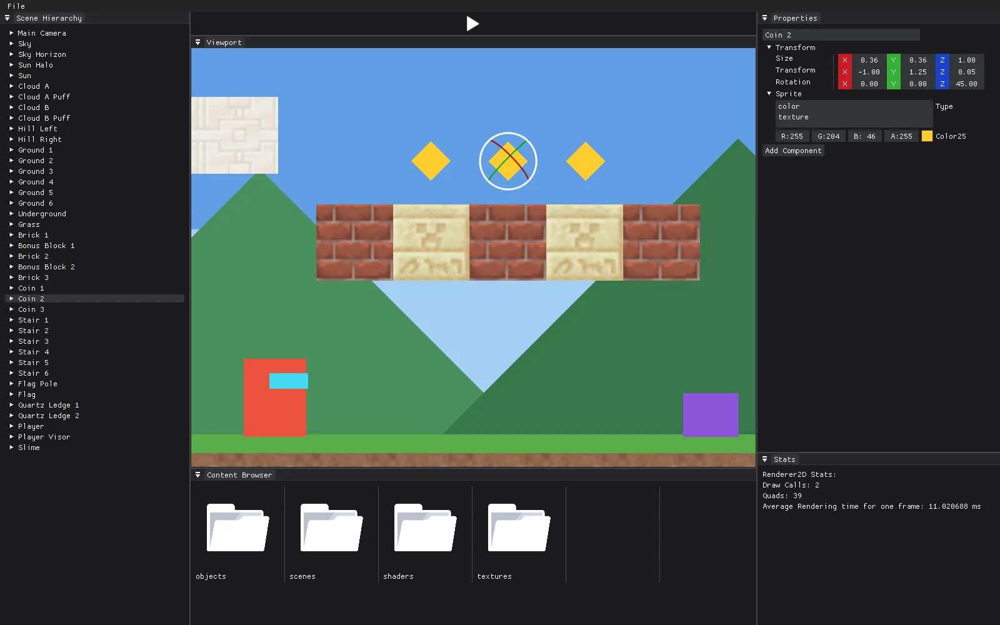

# GameEngine

A 2D game engine and level editor in Java, built on OpenGL 4.5 with LWJGL. It follows the architecture of [TheCherno's Hazel](https://github.com/TheCherno/Hazel) engine, ported from C++ to Java.

 

The screenshots show a demo level; scene files aren't kept in the repo.

## Features

- A level editor with docking panels: scene hierarchy, properties, content browser and render stats.
- Entities with a sprite (a colour or a texture), moved, rotated and scaled with gizmos.
- Click an entity in the viewport to select it.
- Scenes saved and opened as YAML, with stable IDs for every entity. Drag textures and scenes in from the content browser.
- Orthographic and perspective cameras, plus an editor camera that orbits, pans and zooms.

## How it works

- **Batch renderer:** up to 2,000 quads per draw call with 32 texture slots. Slot 0 is a white texture, so plain colours share the same shader.
- **Entity-component system:** built on artemis-odb, with Tag, Id, Transform, Sprite and Camera components. Camera updates and rendering run as systems.
- **Mouse picking:** each entity's ID is drawn into a second framebuffer attachment, and the pixel under the mouse is read back.
- **OpenGL 4.5** with direct state access, and GL debug output routed to log4j.
- **Layers and events:** input arrives as events that pass through a layer stack, as in Hazel.
- The engine reaches OpenGL only through interfaces, so another graphics API could be added.

## Editor controls

| Action | Keys |
| --- | --- |
| New, open, save, save as | Ctrl+N, Ctrl+O, Ctrl+S, Ctrl+Shift+S |
| No gizmo, move, rotate, scale | Q, W, E, R (hold Ctrl to snap) |
| Duplicate the selected entity | Ctrl+D |
| Orbit, pan, zoom the camera | Alt + left, middle, right mouse; or scroll to zoom |

## Modules

- `GameEngine`: the engine.
- `Editor`: the level editor.
- `SandBox`: a test app that draws a 50×50 grid of coloured quads with the batch renderer.

## Running it

You need JDK 17 (the Gradle 7.4 wrapper doesn't run on newer JDKs), a GPU with OpenGL 4.5, and Windows x64 (the LWJGL and ImGui natives are set to Windows).

Open the project in IntelliJ IDEA and run `Editor/src/main/java/Main.java` with the working directory set to `Editor/src/main`, because assets load by relative path. The sandbox runs the same way, from the same working directory.

On a fresh clone the editor's panels open floating; drag them into the window to dock them.
